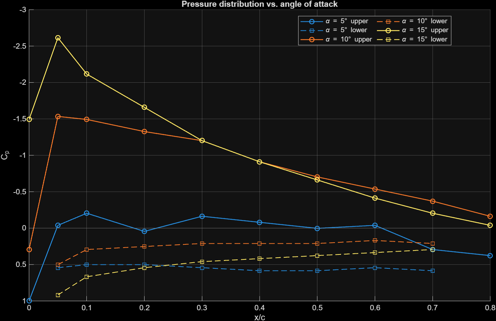
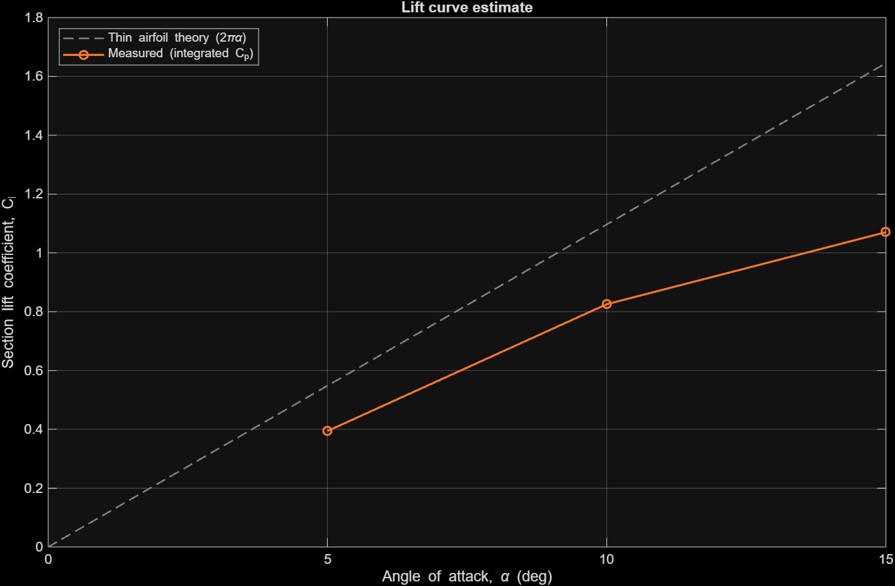
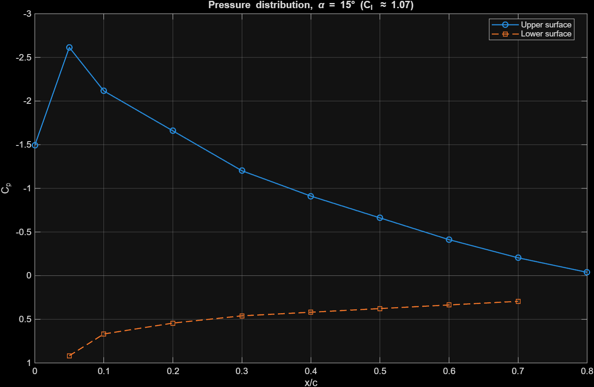

# Wind Tunnel Airfoil Pressure Analysis

**AE 1601: Introduction to Aerospace Engineering · Georgia Tech · Fall 2024**

I measured the pressure distribution around an airfoil in Georgia Tech's educational wind tunnel at several angles of attack. Then I built a MATLAB script that turns the raw manometer readings into pressure coefficient (Cp) plots and a lift estimate.



## What I did

1. **Took the data.** The airfoil has 18 pressure taps (10 upper surface, 8 lower), each connected to a water manometer. I set the tunnel to 1500 RPM (~70 mph) and recorded the liquid height in every tube at α = 5°, 10°, and 15°.
2. **Converted heights to Cp.** Each tube is open to the room on one end, so the tap pressure is `p = p_amb − ρ_w·g·h`. The tunnel pulls air from the room, so ambient pressure is the stagnation pressure and the freestream static pressure is `p∞ = p_amb − q`. Substituting into the definition of Cp:

   ```
   Cp = (p − p∞) / q = 1 − ρ_w·g·h / q
   ```

3. **Estimated lift.** I integrated `(Cp_lower − Cp_upper)` along the chord to get the normal-force coefficient, then took `Cl ≈ Cn·cos α`.

## Results

| α | Peak suction (min Cp) | Cl (integrated) | Thin airfoil theory (2πα) |
|---|---|---|---|
| 5° | −0.20 | 0.39 | 0.55 |
| 10° | −1.53 | 0.83 | 1.10 |
| 15° | −2.61 | 1.07 | 1.64 |

<p float="left">
  
  
</p>

**What the data shows:**
- **Suction drives lift.** As α goes up, the upper surface suction peak near the leading edge grows sharply (Cp from −0.2 to −2.6). The lower surface stays near positive Cp. Most of the lift comes from the upper surface.
- **The stagnation point moves.** At 5°, the leading-edge tap reads Cp = 1.0 (stagnation). At 10° and 15°, the leading-edge tap goes negative because the stagnation point has moved back onto the lower surface.
- **The lift curve is flattening.** Cl rises 0.44 from 5° to 10° but only 0.24 from 10° to 15°. That's the start of the nonlinear region before stall. The recorded data stops at 15°, so the stall angle itself isn't captured here.
- **Measured lift is below thin airfoil theory.** That's expected. The model has finite span, the tunnel walls affect the flow, and the taps stop at 70 to 80% chord, so part of the pressure difference near the trailing edge is never measured.

## Data issues I found

Rebuilding this in code made me look at the raw data more closely than the original lab did:

- **α = 0° was not recorded.** Every tube reads 0, which would mean Cp = 1 everywhere. That's physically impossible with air moving. The script leaves it out.
- **Freestream speed.** The lab handout lists 75, and the class spreadsheet uses 70 mph. I used 70 to match the spreadsheet calculations. Using 75 would lower q by ~13% and shift every Cp slightly.
- **The α = 5° upper surface is noisy.** The upper surface Cp hovers near zero with no clear suction peak, which doesn't match the expected shape. It's most likely a reading error or a tube that wasn't settled.

## Run it

In MATLAB (R2020a or newer), from this folder:

```matlab
cp_analysis
```

The data is in `data/manometer_heights.csv`. The plots save to `figures/`.

## Tools
MATLAB · Educational wind tunnel with water manometer bank
